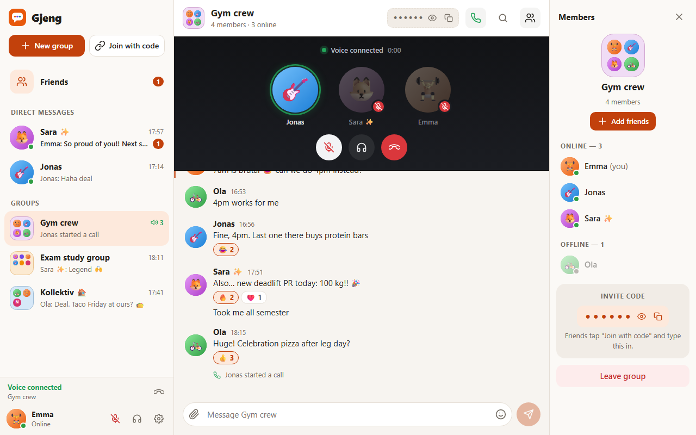
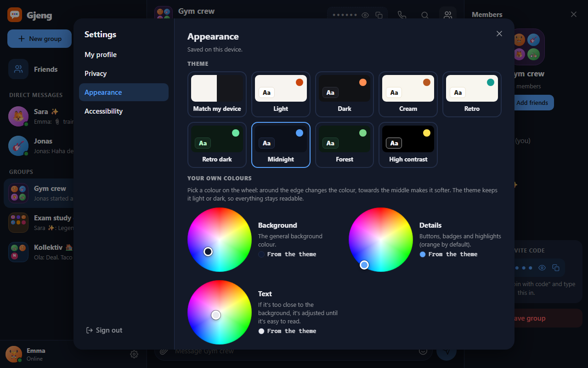

# Build log: how Gjeng was made with AI

**AI tool:** Claude Code (model: Claude Opus 5.5), running as an extension in VS Code. The AI wrote the code, ran the tests, took screenshots and looked at them, and fixed what it found. I made the decisions about what to build and checked the results.

**Time:** about one afternoon (24 Oct 2026), plus polishing.

## 1. Brainstorming

I gave the AI the assignment text and asked for app ideas. It came back with several rounds of suggestions, and I said no to most of them:

| Round | Ideas | What I decided |
| --- | --- | --- |
| 1 | Shared flat app, study planner, student event app, textbook marketplace | Asked for other ideas |
| 2 | Pay tracker for part-time jobs, focus timer with a growing plant, Secret Santa draw, room booking, party word game, gym logger | Pay tracker: workplaces already do this. Didn't like the others either |
| 3 | Ideas based on my hobbies (lifting, drawing, gaming, making games, factory work): gym tracker as an RPG, pixel art editor, machine downtime log, drawing practice timer | Gym trackers are overdone, even with a twist |
| 4 | Factory tools, playable level maker, draw-your-own-enemy game, dialogue writer for games, draw & guess (like skribbl.io), and more | Decided on something else |

I picked **a chat and group app** (option C, "recreate or improve an existing app", inspired by Messenger/Discord). The AI suggested the name **Gjeng** (Norwegian for "the gang") and I liked it.

The AI also read the VibeOff publishing rules first. They say: no real company APIs, only made-up data, and no copied logos. That ruled out ideas that depend on outside services, and it's why everything runs on our own small server.

## 2. Plan

Features (kept to a few that should work well):

1. Join with a name and colour, with no password, so there are no passwords to leak.
2. Groups with 6-character invite codes (no `0/O` or `1/I`, so codes are easy to read out loud).
3. Live messages, typing indicator, online status and emoji reactions.

Technology: React front end, Node.js server with Socket.IO for real-time updates, data saved in a JSON file. No database or API keys needed.

## 3. Key prompts

- *"I think just a basic chat and group application could be better."*
- *"I like the name Gjeng then! Lets get started."*
- After trying the first version: *"I think the messages should not be shown left to right, as that fits a phone view more. It should instead be all to the left of the page and show the profile picture and name with their message under. So it should show your name instead of something like 'You' or a different colour."*
- *"Would it be possible to add voice chat into this webapp or is that not possible with a weak server connection? We should also be able to add friends for more direct messages."*

From there the AI planned the structure, wrote the server, the chat logic, the React app and the styles, and wrote tests for all of it.

## 4. Testing

There are two kinds of automated tests:

- **17 unit tests** for the chat logic, for example: you can't post in a group you're not in, wrong invite codes are rejected, reactions toggle on and off, and the history is capped at 500 messages.
- **5 browser tests** with Playwright that open *two separate browsers* (two people) and check that:
  - messages, typing indicators and reactions show up for the other person,
  - a wrong invite code shows an error,
  - unread badges appear and go away when you open the group,
  - chats survive a page reload,
  - leaving a group works and the others see it.

The AI also took screenshots in desktop, phone and dark mode and **looked at them** to find visual problems.

## 5. Problems found and fixed

| What went wrong | How it was found | Fix |
| --- | --- | --- |
| The emoji reaction bar appeared **on top of** the message you hovered over and covered short messages completely | A browser test couldn't reach the message because the bar was in the way | Moved the bar *beside* the message, or above it on phones |
| The chat **didn't scroll to the bottom** when a reaction made the list taller, so the last message was cut off | Looking at a screenshot | Scroll after every update while you're at the bottom, not only when a new message arrives |
| The reaction bar **stayed open** after clicking a reaction | Screenshot | Only keep it open for keyboard focus (`:focus-visible`), not after a mouse click |
| "Join with code" **wrapped onto two lines** in the sidebar | Screenshot | Slightly wider sidebar and no wrapping |
| Some tests failed because each message appears twice: in the chat and as the preview in the group list | Test output | Made the tests look only inside the message area |
| Screenshots showed half-faded menus and buttons | Screenshot. The AI measured the opacity in the browser and found an animation that hadn't finished | Only the screenshot script needed fixing (wait for animations), not the app |

Problems handled before they happened:

- **Phones on the same Wi-Fi use plain `http://`**, where browsers turn off `crypto.randomUUID()` and the clipboard API. The app uses fallbacks for both, so joining and copying invite codes work on phones too.
- **No crashes if browser storage is blocked** (private mode), because every read and write of saved data is wrapped in error handling.

## 6. Changes after trying it myself

The first version showed messages like a phone chat: other people's messages on the left in white bubbles, and yours on the right in orange. Everyone's messages are now on the left, Discord/Slack style:

- Each message has the person's profile picture, their **name** and the time, with the message underneath.
- Your own messages look the same as everyone else's and show your name, not "You". This also applies to the group list preview and the reaction tooltips.
- Several messages in a row from the same person are grouped under one name. Pointing at one shows its time.
- The reaction bar now pops up in the top-right corner of the message instead of beside a bubble.

A new browser test checks that your own messages show your name.

## 7. Friends and direct messages

Added after I asked for a way to message people one-on-one:

- Everyone gets a **friend code**. You can add someone by code, or with "Add friend" next to them in a group's member list.
- The other person sees a badge and a notice, and can **accept or decline**. If two people ask each other, they become friends straight away.
- Friends get a **Message** button that opens a private chat. Direct messages reuse everything groups already had: live messages, typing, reactions and unread badges.
- The sidebar is now split into **Friends**, **Direct messages** and **Groups**.
- Rules the server checks: you can only message friends, you can't add yourself, friend codes aren't shown to other people, and direct messages can't be joined by code.

Tests: 11 new unit tests (28 in total) and 2 new browser tests (7 in total). One adds a friend by code, accepts and sends a direct message. The other adds a friend from a group's member list. Both passed the first time.

While checking the screenshots, the AI noticed a notice that seemed to never go away. Before changing anything, it measured how long the notice was visible: it disappeared after 2.5 seconds as intended, and the screenshots had just been taken quickly. So the screenshot script was fixed, not the app.

I also asked whether **voice chat** would work with a weak server. The AI explained that voice would go directly between the browsers (WebRTC), with the server only connecting people, so the server's connection isn't the problem. The catch is that browsers only allow the microphone on `https` or `localhost`.

## 8. Group icons and a Discord-style member list

My prompts:

- *"Add all profiles in like an app folder for the group chat, so it shows the larger icon with all members icons."*
- *"For a group, show active group members on a tab to the right similar to Discord's solution."*

What changed:

- **Group icons look like an app folder on a phone.** They're a rounded square, tinted in the group's colour, with every member's profile picture inside. Up to 4 members fit in a 2×2 grid, bigger groups get a 3×3 grid, and if there are more than 9 the last spot shows "+N". A large version sits at the top of the member list.
- **Member list on the right, like Discord.** It's open by default on wide screens and split into "Online — N" and "Offline — N", with offline people faded. You can hide it with the members button and it remembers that. On smaller screens and phones it slides over the chat instead, so it doesn't squeeze the messages.
- To keep the list calm, "Message" and "Add friend" only appear when you point at someone. "Accept" always shows, because it needs an answer. On touch screens all buttons show, since there's no pointing there.

A new browser test checks the Online/Offline sections (one person closes the app and moves to Offline) and that hiding the list is remembered after a reload. The old tests had clicked a button to *open* the member list, and now it's already open, so they were updated. That was 8 browser tests in total, all passing.

## 9. Usernames, adding friends to groups, and demo data

My prompts:

- *"How about first making usernames more exclusive and having the friend codes based on the username? So it's easier to add friends. I also think when a friend is added their DM should automatically be opened. For both people it also says 'No friends' in the friends tab."*
- *"Also add an option to add or invite people from your friend list to a group."*
- *"When launching the app, how about having already created some users who share friends among each other, with for example 3 different groups of different combinations and some already typed messages. Would look good for the demo I think."*

**The "No friends" problem.** Before changing any code, the AI looked at the data the server had saved from my testing. Frederik and Ola had a direct message with messages in it, so they *had* been friends, and the friendship had later been removed. That only happens through the ✕ next to a friend, which looked like a "close" button but meant "Remove friend". So it was a confusing design rather than a crash, and the ✕ became a clearly labelled "Remove friend" button.

What changed:

- **Usernames are unique** (upper/lower case doesn't matter) and can be typed: 2–20 letters or numbers, no spaces, æøå allowed. The join screen asks the server while you type and shows "✓ Available" or "already taken". Friend codes are gone: **you add friends by typing their username**.
- **Accepting a friend request creates your direct message straight away.** The person who accepts lands in it. The person who asked also jumps there if they were waiting on the Friends page, and otherwise it shows up in their list.
- **Add friends to a group:** an "Add friends" button in the member list opens your friends who aren't in the group yet, each with an "Add" button. The group sees "Emma added Jonas".
- **Demo mode (`npm run demo`):** seven made-up people (Emma, Jonas, Sara, Ola, Noah, Ingrid, Maja) who are friends in different combinations, three groups (Gym crew, Kollektiv, Exam study group), three direct messages, reactions and a waiting friend request. The join screen offers **"Jump in as …"** buttons. The demo resets every time it starts and is kept apart from real data.

Tests: 35 unit tests and 10 browser tests, all passing. New ones cover unique usernames, adding by username, the DM opening on both sides after accepting, adding friends to a group, and that the demo data is complete and in time order. Because usernames are unique now, the browser tests give each person a name like `Ada_k3f9`, so the tests don't clash with each other.

## 10. Voice calls, profiles, status, files and a resizable layout

This was the biggest round. I gave the AI a screenshot of Discord's call screen and a list of wishes, then left it to work on its own while I was away.

My prompts (shortened):

- *"Add voice calls, both in direct messages where two people call and group calls where multiple profiles appear at the top, similar to Discord's call UI. A little icon should appear when a participant is talking, and when someone is muted, darken their whole profile picture as well as showing a little mute icon. When only one participant is in the call it should still begin, and they can wait there."*
- *"Allow setting profile pictures, and changing display names, not account names."*
- *"Add thumbs down and angry face to reactions. The group code should be a bit more hidden, in case someone is peeking at your phone in public."*
- *"Have your own messages slightly highlighted, but don't mix it with the hover highlight. Add an emoji button and an attach file/image button. The little scrollbar in the message box clips weirdly and isn't needed for short messages."*
- *"Make it possible to widen or narrow the side panels. Show your own status in the bottom-left corner."* (With a screenshot where I'd drawn arrows on the panel edges.)

Earlier I'd asked whether voice chat would even work with a weak server. The AI explained that the sound goes **directly between the browsers** (WebRTC). The server only introduces them to each other, so the server's connection isn't the bottleneck.

What was built:

- **Voice calls** in groups and DMs. The call area at the top of the chat is styled after the Discord screenshot:
  - One bubble per person.
  - A green ring and speaker icon on whoever is **talking**. The app measures each person's volume a few times a second.
  - **Muted or deafened** people are darkened, with a red icon.
  - Buttons to mute, deafen and leave, plus a timer.
  - You can start a call alone and wait.
  - DM calls **ring** on the friend's screen, unless they're on Do not disturb.
  - The chat notes "Emma started a call" and "Call ended after 3 minutes".
  - The sidebar shows which chats have a call going on.
- **Bottom-left corner (like Discord):** your picture, name and status. You pick Online, Away or Do not disturb, and everyone sees it as a coloured dot. While you're in a call you also get mute, deafen and "Voice connected".
- **Profiles:** upload a picture (shrunk in the browser first) and set a display name with spaces and emoji. The username stays, since friends add you by it. Names and pictures update everywhere at once, even on old messages.
- **Pictures and files** in messages (also by pasting a screenshot), with an **emoji picker** that adds the emoji where your cursor is. Pictures open big; other files are always downloaded, never opened in the browser.
- **Your own messages** get a thin orange bar on the left. Hovering adds a grey background instead, so the two marks never mix.
- **Hidden invite codes:** shown as •••••• until you press Show, and they hide again after 20 seconds. Copying works without showing them.
- **Resizable side panels:** drag the edges, or use the arrow keys on them. Widths are remembered, and double-click resets them.
- **The message box** only shows a (thin) scrollbar once the text is too long, and all scrollbars are thinner now.
- **👎 and 😡** reactions.
- **HTTPS mode** (`npm run demo:https`), because phones only allow the microphone on https.
- **Demo people** got emoji profile pictures (drawn in code, not real photos), and Sara and Noah got display names.

How it was tested:

- **46 unit tests**, including:
  - Profile pictures must be real photos: an SVG with hidden code is refused.
  - File names are made safe: `../../notes?.pdf` becomes `.._.._notes_.pdf`.
  - Files over 1 MB are refused.
  - Statuses, and call notes with durations.
- **18 browser tests.** The call test uses Chrome's **fake microphone**, which beeps. It checks that Ada's beep actually travels to Bo and lights up her "talking" ring on his screen. That proves the sound really flows between two browsers, not just that the buttons work. Other tests cover:
  - muting
  - leaving
  - a DM call ringing and being answered
  - profiles updating for others
  - status dots
  - pictures, files and emoji
  - the own-message marker
  - dragging the panels and the widths being remembered after a reload

All 18 passed on the first run.

Problems found in the screenshots and fixed:

- The message box showed **two focus outlines** on phones (the box and the text field inside it).
- The 📞 icon in call notes had **no space** before the text.
- While building, the AI also caught that the emoji picker would have **moved keyboard focus every time the screen updated**, and fixed it before it showed up.

## 11. Settings, privacy, themes, accessibility, profile cards, search and GIFs

My prompts (shortened):

- *"When scaling the left tab down, 'Join with code' overlaps with the other tab. Maybe it should compact into just the icons."*
- *"An improved settings tab with privacy settings like 'who can add me as a friend' and 'who can see my friends', an appearance page with colour wheels for the background, the orange details and the text (forcing contrast if the colours are too similar), some base themes like dark, light, retro, retro dark and cream, and an accessibility page. Accessibility mode could also be a toggle when registering."*
- *"Make profile pictures clickable to open a small profile card with shared groups or shared friends, depending on privacy settings. Let people change their profile banner. Have some default profile pictures to choose from."*
- *"Is it possible to include a GIF tab with the emojis, or do you need a licence or agreement with sites like GIPHY?"*
- *"A way to search through all messages in a DM or group chat, filtered by user and type of message, and by keywords."*

**About GIFs:** the AI explained that GIPHY and Tenor need an API key and acceptance of their terms (for example showing "Powered by GIPHY"), and that VibeOff's rules don't allow calling company APIs anyway. So instead it made **animated stickers that the app draws itself** and turns into real GIF files in the browser, with a small open-source encoder (gifenc, MIT licence). The GIF tab also has "Recent" (GIFs sent in your chats), favourites and search.

What was built:

- **Sidebar buttons** shrink to just their icons when the sidebar is dragged narrow. The sidebar measures its own width with a CSS container query.
- **A settings window** with four tabs:
  - **My profile:** upload a picture or pick one of 16 built-in ones, and set a display name, "About me", a name colour, and a banner colour or banner picture. A live preview of your profile card sits next to it.
  - **Privacy:** who can send you friend requests, who can see your friends, and whether others see when you're online. **The server enforces these**, not just the app.
  - **Appearance:** 9 themes, plus three **colour wheels** (background, details and text). The theme decides how light or dark each colour is, so a bright pick doesn't make the app unreadable. The text colour is checked against WCAG contrast rules and **adjusted until it's readable**, and the app says so when that happens.
  - **Accessibility:** text size (90–150%), high contrast, less motion, status symbols (a moon for away, a line for do not disturb, a ring for offline), stronger focus outlines, easier-to-read text, always-visible message times, and screen-reader announcements on or off. **Accessibility mode** turns it all on at once, and it can also be ticked on the sign-up screen.
- **Profile cards:** click any picture or name (in messages, the member list, the Friends page, calls or the DM header). They show the banner, status, about me, member since, shared groups and mutual friends. If that person hides their friends, the card says "Hidden by their privacy settings."
- **Message search:** search one chat or all chats by words, person and type (text, pictures and GIFs, files, links). Matching words are highlighted, and clicking a result scrolls to the message and lights it up.

How it was tested:

- **54 unit tests** (8 new), including:
  - every privacy option
  - mutual friends being hidden for the right people
  - profile cards
  - built-in pictures (unknown ones refused)
  - banners, and "About me" length limits
- **26 browser tests** (8 new), including:
  - privacy blocking a friend request and hiding someone's online status
  - mutual friends disappearing from a card after a privacy change
  - picking a text colour that's too dark, then checking in the browser that the contrast is still at least 4.5 : 1
  - text size really changing the font size (15 px → 19.5 px at 130%)
  - accessibility mode from sign-up
  - search with every filter, and jumping to a result
  - sending a GIF sticker (checking it really is a GIF file) and favouriting it
  - the narrow sidebar

Problems found and fixed:

- **Privacy choices lagged** (found by a test): a choice only showed as selected once the server had answered. They now change straight away and roll back if saving fails.
- **Message author names shrank** to the size of the timestamp after names became clickable (found in a screenshot). The new button style was overriding the name's style.
- **The profile card had a big gap** under the picture, and the settings window's "Save changes" bar was partly cut off (both found in screenshots).
- **Clearing a theme would have wiped the text size** as well, since both are stored in the same place. The AI caught this while writing the code, before it caused a bug.
- Three test mistakes, such as a test that sent a message to the wrong chat after two people became friends and their DM opened.

## 12. What surprised me

How efficient the AI was, and how well it understood what I meant even when my prompts weren't well structured.

## 13. What I'd add next

- Video and screen sharing in calls
- Editing and deleting messages
- Proper accounts so you can log in on a new device
- Push notifications
- Hosting it online, with a relay server so calls work across different networks
