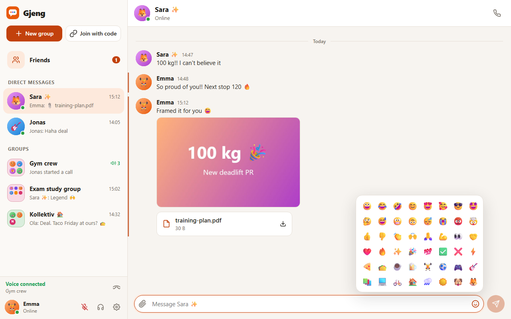
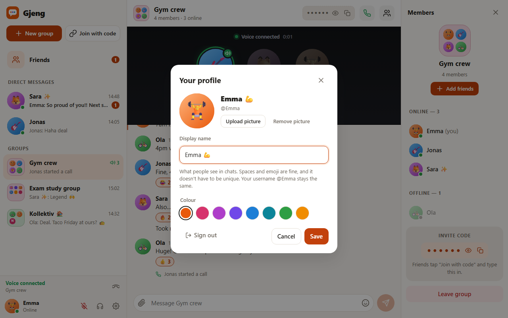

# Gjeng

**Real-time group chats and voice calls for your crew.** Make a group, add your friends, talk, and call.

*Gjeng* is Norwegian for "the gang", meaning your group of friends.

Made for Mandatory Assignment 3 (Vibe Coding) at OsloMet. It was built with Claude Code as the AI coding tool. See [BUILD_LOG.md](BUILD_LOG.md) for how AI was used, what was tested and what was fixed along the way.


| Group chat | Friends |
| --- | --- |
|  |  |

| Pictures, files and emoji | Your profile |
| --- | --- |
|  |  |

| Phone | Dark mode |
| --- | --- |
|  |  |

## What it does

- **Join with a unique username.** The join screen checks live whether the name is free. There's no password, so nothing sensitive is stored.
- **Profiles:** upload a profile picture, set a display name (spaces and emoji are fine) and pick a colour. Your username stays the same, since friends add you by it.
- **Status:** Online, Away or Do not disturb, shown bottom-left and as a coloured dot for everyone else. Do not disturb hides incoming call pop-ups.
- **Groups:** create a group, add your friends straight in or share an invite code. The code stays **hidden** (••••••) until you press Show, so people next to you can't read it off your screen.
- **Live chat:** messages show up instantly. It also shows "Jonas is typing…" and who is online. Your own messages have a thin coloured bar on the left.
- **Pictures, files and emoji:** attach a picture or file (or paste a screenshot), and add emoji from the picker. Pictures open big when clicked; other files download.
- **Reactions:** 👍 👎 ❤️ 😂 😮 😡 🔥
- **Voice calls** in groups and direct messages, with a call area like Discord's:
  - Everyone in the call shows as a bubble. Whoever is **talking** gets a green ring and a speaker icon.
  - **Muted** people are darkened and get a mute icon. There's also deafen, and you can wait alone until others join.
  - Calling a friend in a DM **rings** on their screen.
  - The chat notes when a call started and how long it lasted.
- **Friends and direct messages:** add people by username or from a group's member list. Accepting opens your direct message right away.
- **Discord-style layout:** group icons like an app folder (with every member's picture), a member list split into Online and Offline, and **side panels you can drag wider or narrower**. Your widths are remembered.
- **Unread badges**, **phone layout**, **dark mode**, and chats saved on the server.

## Run it

You need [Node.js](https://nodejs.org) 22 or newer.

```bash
npm install
npm run build
npm start
```

Then open <http://localhost:3000>.

**To show it off:** `npm run demo` starts Gjeng with seven made-up people. They are already friends, with three groups, direct messages, profile pictures and a chat history. On the join screen, click **"Jump in as Emma"** (or anyone else). The demo resets every time it starts, and it's kept apart from your real data.

- **To be two people on one computer:** open a second window in private/incognito mode, or use <http://127.0.0.1:3000> in the same browser. Each one counts as a different person. For calls on one computer, use headphones, or you'll hear an echo.
- **Calls on phones:** browsers only allow the microphone on `https` (or `localhost`). Run `npm run demo:https`, open the `https://192.168.x.x:3000` address it prints, and accept the warning about the homemade certificate once. Windows may ask you to let Node.js through the firewall.
- **While developing:** `npm run dev` starts the server and a hot-reloading front end on <http://localhost:5173>.

## Tests

```bash
npm test                      # 46 unit tests: chat, friends, profiles, files, calls, demo data (Vitest)
npx playwright install chromium   # first time only
npm run test:e2e              # 18 browser tests with two or more people (Playwright)
npm run screenshots           # starts a demo server and saves screenshots to captures/
```

The browser tests use Chrome's fake microphone, which plays a beep. The call test checks that one person's beep actually reaches the other person and lights up the "talking" ring.

## How it's built

| Part | Technology |
| --- | --- |
| Front end | React 19, built with Vite |
| Server | Node.js with Express and Socket.IO (WebSockets for the live updates) |
| Voice calls | WebRTC, straight between the browsers. The server only introduces them to each other. |
| Storage | One JSON file (`data/gjeng.json`). Files from messages are kept apart from the chat history and fetched by link. |
| Tests | Vitest (logic) and Playwright (real browsers) |

```
client/      React app (components, the useChat hook, voice.js for calls, styles)
server/      Express + Socket.IO server, the chat logic (store.js) and the demo data
shared/      Limits, colours and reactions used by both sides
e2e/         Browser tests
scripts/     Screenshot script
```

The server checks everything: who is in a group, message and file sizes, that profile pictures are real photos, valid reactions and so on. The browser can't be trusted, so it doesn't decide any of that. Files that aren't pictures are always downloaded, never opened in the browser.

## Limitations

This is a prototype, not a finished product:

- **No real login.** Your identity is a random ID saved in the browser. If you clear site data or sign out, you need invite codes to get back into your groups.
- **Calls work on the same network.** Calling across the internet would need a relay server (STUN/TURN), and those are run by outside companies. In a call, everyone connects to everyone, which suits small groups.
- **One server and one data file.** That's fine for a class demo, but it wouldn't hold up with lots of users. Files can be at most 1 MB.
- No editing or deleting messages.
- All names, pictures and messages in the demo and screenshots are made up.
