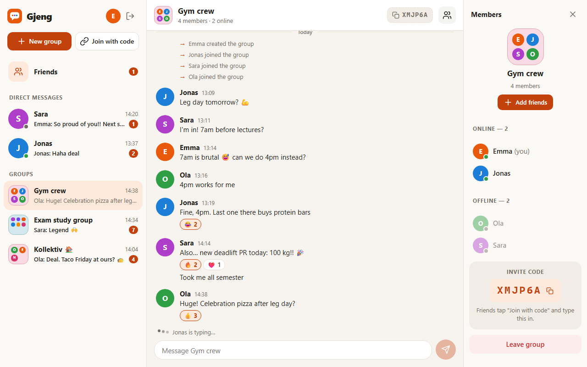
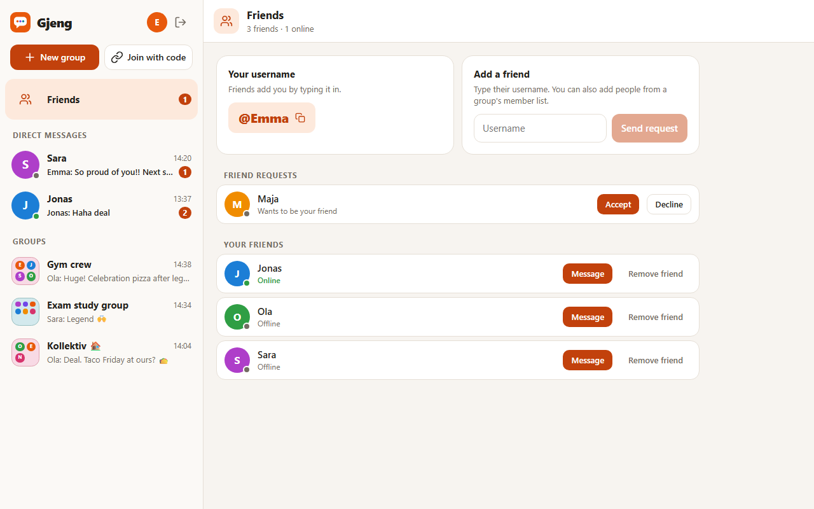
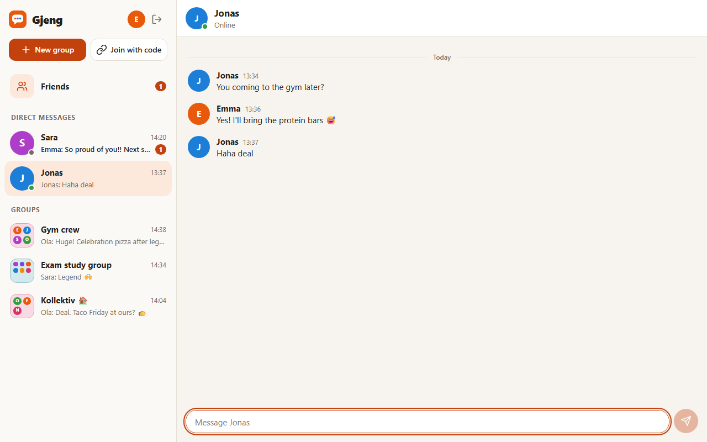
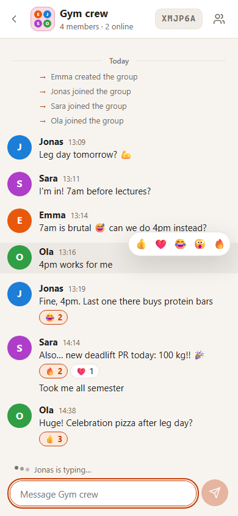
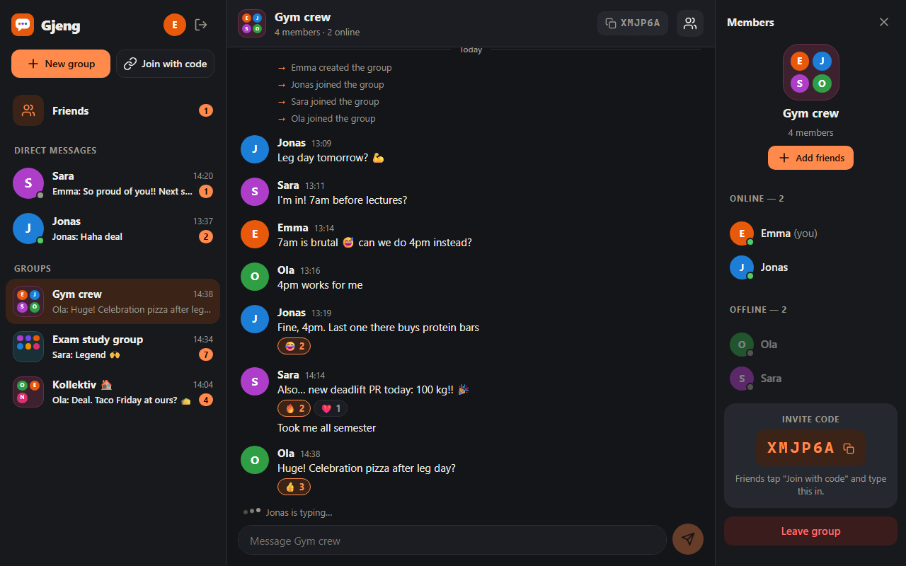

# Gjeng

**Real-time group chats for your crew.** Make a group, share the 6-character invite code, and start talking.

*Gjeng* is Norwegian for "the gang", meaning your group of friends.

Made for Mandatory Assignment 3 (Vibe Coding) at OsloMet. It was built with Claude Code as the AI coding tool. See [BUILD_LOG.md](BUILD_LOG.md) for how AI was used, what was tested and what was fixed along the way.



| Friends | Direct message |
| --- | --- |
|  |  |

| Phone | Dark mode |
| --- | --- |
|  |  |

## What it does

- **Join with a unique username and a colour.** The join screen checks live whether the name is free. There's no password, so nothing sensitive is stored.
- **Groups:** create a group, invite people with a code like `K7P2QX` or add your friends straight in, join other groups with their code, and leave when you want.
- **Live chat:** messages show up instantly for everyone in the group. It also shows "Jonas is typing…" and who is online.
- **Group icons like an app folder:** every member's picture inside the group's icon, with "+N" for big groups.
- **Member list on the right** (like Discord), split into Online and Offline.
- **Friends and direct messages:** add people by typing their username or straight from a group's member list. When a request is accepted, your direct message opens right away.
- **Emoji reactions** on messages (👍 ❤️ 😂 😮 🔥).
- **Unread badges** in the group list and in the browser tab title.
- **Works on phones** (one screen at a time, with a back button) and in **dark mode**.
- **Chats are saved** on the server, so they are still there after a restart or reload.

## Run it

You need [Node.js](https://nodejs.org) 22 or newer.

```bash
npm install
npm run build
npm start
```

Then open <http://localhost:3000>.

**To show it off:** `npm run demo` starts Gjeng with seven made-up people who are already friends, three groups, direct messages and a chat history. On the join screen, click **"Jump in as Emma"** (or anyone else). The demo resets every time it starts, and it's kept apart from your real data.

- **To be two people on one computer:** open a second window in private/incognito mode, or use <http://127.0.0.1:3000> in the same browser. Each one counts as a different person.
- **To chat with a friend on the same Wi-Fi:** the server prints an address like `http://192.168.x.x:3000` that works on phones. Windows may ask you to let Node.js through the firewall.
- **While developing:** `npm run dev` starts the server and a hot-reloading front end on <http://localhost:5173>.

## Tests

```bash
npm test                      # 35 unit tests for the chat, friends and demo data (Vitest)
npx playwright install chromium   # first time only
npm run test:e2e              # 10 browser tests where two people chat and become friends (Playwright)
npm run screenshots           # starts a demo server and saves screenshots to captures/
```

## How it's built

| Part | Technology |
| --- | --- |
| Front end | React 19, built with Vite |
| Server | Node.js with Express and Socket.IO (WebSockets for the live updates) |
| Storage | One JSON file (`data/gjeng.json`) |
| Tests | Vitest (logic) and Playwright (real browsers) |

```
client/      React app (components, the useChat hook, styles)
server/      Express + Socket.IO server and the chat logic (store.js)
shared/      Limits, colours and reactions used by both sides
e2e/         Browser tests
scripts/     Screenshot script
```

The server checks everything: who is a member of a group, message length, valid reactions and so on. The browser can't be trusted, so it doesn't decide any of that.

## Limitations

This is a prototype, not a finished product:

- **No real login.** Your identity is a random ID saved in the browser. If you clear site data or sign out, you need invite codes to get back into your groups.
- **One server and one data file.** That's fine for a class demo, but it wouldn't hold up with lots of users.
- **Text only:** no images, no editing or deleting messages.
- All names and messages in the screenshots are made up.
